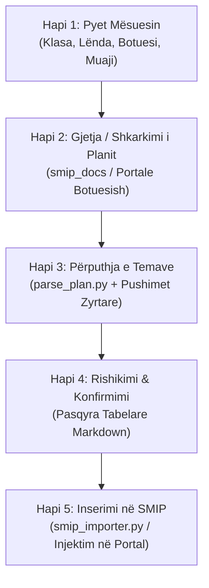

# SMIP Skill - Automatizimi i Regjistrit Mësimor Parauniversitar

Ky skill ofron një rrjedhë të plotë nga marrja e të dhënave të mësuesit deri te regjistrimi përfundimtar i temave në portalin zyrtar [smip.al](https://smip.al/teacher/registry?tab=daily-register).

---

## Rrjedha e Punës (Workflow me 5 Hapa)



---

## Hapi 1: Mbledhja Interaktive e të Dhënave

Kur përdoruesi dëshiron të hedhë tema në SMIP, nëse nuk janë specifikuar të gjitha të dhënat, pyeteni mësuesin duke përdorur mjetin `ask_question` ose dialog interaktiv për këto 4 elemente kyçe:

1. **Klasa:** (p.sh. *Klasa 6*, *Klasa 8*, *Klasa 3*, ose klasë e bashkuar *Klasa 6 – 8*)
2. **Lënda:** (p.sh. *Edukim Fizik*, *Anglisht*, *Qytetari*, *Matematikë*, *TIK*)
3. **Shtëpia Botuese / Teksti:** (p.sh. *Albas*, *Mediaprint*, *Pegi*, *Smiles / Express Publishing*, *Irisoft*, etj.)
4. **Muaji dhe Viti:** (p.sh. *Tetor 2026*, *Nëntor 2026*, ose *Shtator 2026*)
5. **Orari Javor:** (Nëse klasa ekziston te [`orari_mesimor.json`](./references/orari_mesimor.json), orari merret automatikisht; përndryshe pyetet cilat ditë zhvillohet mësimi dhe sa orë në ditë).

---

## Hapi 2: Gjetja ose Shkarkimi i Planit Mësimor

Përdorni skriptin ndihmës [`find_curriculum.py`](./scripts/find_curriculum.py) për të kontrolluar planet lokale ose për të shkarkuar nga burimet zyrtare:

```bash
# Kërkim lokal në smip_docs/
python3 .agents/skills/smip/scripts/find_curriculum.py --grade "<klasa>" --subject "<lenda>" --publisher "<botuesi>"
```

### Nëse plani nuk gjendet lokal:
* Përdorni veglën `search_web` ose burimet e integruara të shtëpive botuese:
  * **Albas:** `https://portalishkollor.al`
  * **Mediaprint:** `https://mediaprint.al/planet-mesimore/`
  * **Pegi:** `https://botimepegi.al/plane-mesimore/`
  * **Irisoft:** `https://irisoft.al`
  * **ASCAP:** `https://ascap.edu.al`
* Shkarkojeni skedarin Word/PDF direkt me:
  ```bash
  python3 .agents/skills/smip/scripts/find_curriculum.py --download-url "<URL>" --output-name "<emri_skedarit.docx>"
  ```

---

## Hapi 3: Analiza dhe Përgatitja e Temave Ditore

Përdorni skriptin [`parse_plan.py`](./scripts/parse_plan.py) për të:
1. Nxjerrë të gjitha temat mësimore dhe situatat e parashikuara të të nxënit nga skedari `.docx`.
2. Llogaritur datat e sakta të orëve duke përjashtuar fundjavat dhe festat zyrtare nga [`kalendari_pushimeve.json`](./references/kalendari_pushimeve.json).
3. Përcaktuar numrin rendor të orës fillestare (`--start-index`) nëse muaji paraprak ka konsumuar një pjesë të temave.

```bash
python3 .agents/skills/smip/scripts/parse_plan.py \
  --file "smip_docs/<skedari_planit.docx>" \
  --grade "<klasa>" \
  --subject "<lenda>" \
  --month <muaji_numerik> \
  --year <viti> \
  --days '<json_ditet_dhe_oret>' \
  --start-index <indeksi_i_temes_se_ardhshme> \
  --output-json "temat_<muaji>_<viti>.json" \
  --output-md "temat_<muaji>_<viti>.md"
```

*Shembull:*
```bash
python3 .agents/skills/smip/scripts/parse_plan.py \
  --file "smip_docs/EDUKIM_FIZIK_6_Plani_me_simor_vjetor.docx" \
  --grade "Klasa 6 - 8" \
  --subject "Edukim Fizik" \
  --month 10 \
  --year 2026 \
  --days '{"E Hënë": 2, "E Premte": 1}' \
  --start-index 8 \
  --output-json "temat_tetor_2026.json" \
  --output-md "temat_tetor_2026.md"
```

---

## Hapi 4: Rishikimi dhe Konfirmimi nga Mësuesi

Përpara inserimit në sistemin SMIP, paraqisni gjithmonë para mësuesit pasqyrën tabelare:
* Numri i orës
* Data e zhvillimit
* Dita e javës
* Titulli i temës mësimore
* Situata e të nxënit

Kërkoni konfirmim me: *"A jeni dakord me këtë planifikim përpara se t'i hedhim në portalin SMIP?"*

---

## Hapi 5: Inserimi nga Agjenti (Lidhja me Google Chrome ose Playwright)

Agjenti mund të lidhet dhe të bashkëveprojë me shfletuesin në **3 mënyra të fuqishme**:

### Mënyra A: Lidhje Direkte me Google Chrome-in Tuaj Ekzistues (CDP - Chrome DevTools Protocol)
Kjo është mënyra më e shpejtë dhe më e përshtatshme kur mësuesi është tashmë i loguar në `smip.al` (p.sh. përmes e-Albania):
1. Hapni Chrome-in tuaj ose lëreni agjentin ta nisë automatikisht:
   ```bash
   node scripts/smip_bot.js --open-chrome --topics "temat_tetor_2026.json" --class "Klasa 6 - 8" --subject "Edukim Fizik" --month "10/2026"
   ```
2. Agjenti lidhet drejtpërdrejt me tab-in aktiv të `smip.al` në Google Chrome-in tuaj, duke shfrytëzuar të gjitha cookies, sesionin dhe llogarinë tuaj aktive. Nuk kërkohet asnjë ri-logim!

### Mënyra B: Përdorimi i Shfletuesit të Integruar në Antigravity (`/browser`)
* Shkruani komandën `/browser` në bisedë me Antigravity.
* Agjenti aktivizon shfletuesin e integruar në IDE dhe kryen veprimet e navigimit dhe plotësimit të regjistrit direkt brenda ndërfaqes së Antigravity.

### Mënyra C: Bot-i Autonom i Pavarur (Playwright Headless / Headful)
```bash
node scripts/smip_bot.js \
  --topics "temat_tetor_2026.json" \
  --class "<klasa>" \
  --subject "<lenda>" \
  --month "<MM/YYYY>" \
  --headful
```
* Ruan gjendjen e sesionit te `.smip_session/storage_state.json` për ekzekutime të ardhshme 100% në prapaskenë (headless).

---

## Skedarët dhe Referencat Kryesore

* Selektorët dhe ndërfaqja e SMIP: [`portal_selectors.md`](./references/portal_selectors.md)
* Orari dhe ngarkesa javore: [`orari_mesimor.json`](./references/orari_mesimor.json)
* Kalendari i festave zyrtare: [`kalendari_pushimeve.json`](./references/kalendari_pushimeve.json)
* Shabllon orari mësimor: [`orari_shembull.json`](./references/orari_shembull.json)
