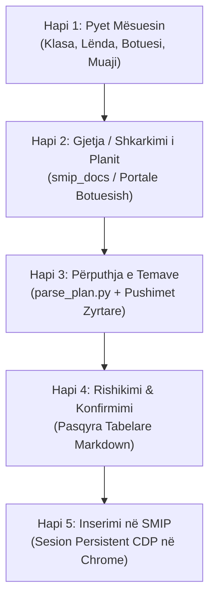

# SMIP Skill - Automatizimi i Regjistrit Mësimor Parauniversitar

Ky skill ofron një rrjedhë të plotë nga marrja e të dhënave të mësuesit deri te regjistrimi përfundimtar i temave në portalin zyrtar [smip.al](https://smip.al/teacher/registry?tab=daily-register).

---

## Rrjedha e Punës (Workflow me 5 Hapa)



---

## Hapi 1: Mbledhja Interaktive e të Dhënave

Kur përdoruesi dëshiron të hedhë tema në SMIP, nëse nuk janë specifikuar të gjitha të dhënat, pyeteni mësuesin duke përdorur mjetin `ask_question` ose dialog interaktiv për këto elemente kyçe:

1. **Klasa:** (p.sh. *Klasa 7-A*, *Klasa 9-A*, ose klasë kolektive e bashkuar si *Klasa 7 & 9*)
2. **Lënda:** (p.sh. *Edukim fizik, sporte dhe shëndeti*, *Anglisht*, *Matematikë*, *TIK*)
3. **Shtëpia Botuese / Teksti:** (p.sh. *Albas*, *Mediaprint*, *Pegi*, *ASCAP/MAS*, etj.)
4. **Muaji dhe Viti:** (p.sh. *Tetor 2026*, *Nëntor 2026*, etj.)
5. **Orari Javor:** (Ditët e javës dhe numri i orëve për ditë).

---

## Hapi 2: Gjetja ose Shkarkimi i Planit Mësimor

Përdorni skriptin ndihmës [`find_curriculum.py`](./scripts/find_curriculum.py) për të kontrolluar planet lokale ose për të shkarkuar nga burimet zyrtare:

```bash
# Kërkim lokal në smip_docs/
python3 .agents/skills/smip/scripts/find_curriculum.py --grade "<klasa>" --subject "<lenda>" --publisher "<botuesi>"
```

### Nëse plani nuk gjendet lokal:
* Përdorni veglën `search_web` ose burimet e integruara të shtëpive botuese:
  * **Albas:** `https://portalishkollor.al`
  * **Mediaprint:** `https://mediaprint.al/planet-mesimore/`
  * **Pegi:** `https://botimepegi.al/plane-mesimore/`
  * **Irisoft:** `https://irisoft.al`
  * **ASCAP:** `https://ascap.edu.al`
* Shkarkojeni skedarin Word/PDF direkt me:
  ```bash
  python3 .agents/skills/smip/scripts/find_curriculum.py --download-url "<URL>" --output-name "<emri_skedarit.docx>"
  ```

---

## Hapi 3: Analiza dhe Përgatitja e Temave Ditore

Përdorni skriptin [`parse_plan.py`](./scripts/parse_plan.py) për të:
1. Nxjerrë të gjitha temat mësimore dhe situatat e parashikuara të të nxënit nga skedari `.docx`.
2. Llogaritur datat e sakta të orëve duke përjashtuar fundjavat dhe festat zyrtare. Nëse kalendari nuk ekziston, motori [`holiday_finder.py`](./scripts/holiday_finder.py) i gjen automatikisht festat zyrtare online ose i llogarit algoritmikisht sipas ligjit shqiptar dhe e ruan vetë skedarin në `smip_docs/kalendari_pushimeve.json`.
3. Përcaktuar numrin rendor të orës fillestare (`--start-index`) nëse muaji paraprak ka konsumuar një pjesë të temave.

```bash
python3 .agents/skills/smip/scripts/parse_plan.py \
  --file "smip_docs/<skedari_planit.docx>" \
  --grade "<klasa>" \
  --subject "<lenda>" \
  --month <muaji_numerik> \
  --year <viti> \
  --days '<json_ditet_dhe_oret>' \
  --start-index <indeksi_i_temes_se_ardhshme> \
  --output-json "temat_<muaji>_<viti>.json" \
  --output-md "temat_<muaji>_<viti>.md"
```

*Shembull:*
```bash
python3 .agents/skills/smip/scripts/parse_plan.py \
  --file "smip_docs/EDUKIM_FIZIK_7_Plani_me_simor_vjetor.docx" \
  --grade "Klasa 7 - 9" \
  --subject "Edukim Fizik" \
  --month 10 \
  --year 2026 \
  --days '{"E Mërkurë": 2, "E Premte": 1}' \
  --start-index 9 \
  --output-json "temat_tetor_2026.json" \
  --output-md "temat_tetor_2026.md"
```

---

## Hapi 4: Rishikimi dhe Konfirmimi nga Mësuesi

Përpara inserimit në sistemin SMIP, paraqisni gjithmonë para mësuesit pasqyrën tabelare:
* Numri i orës vjetore
* Data e zhvillimit
* Dita e javës
* Titulli i temës mësimore
* Situata e të nxënit

---

## Hapi 5: Inserimi në SMIP (Lidhja me Google Chrome mbi CDP)

### Menaxhimi i Lidhjes me Chrome (Sesion i Përhershëm pa Prompt-e)
Për të mos e pyetur përdoruesin çdo herë në Chrome me dialogun e "Remote debugging":
1. Agjenti lexon rrugën e saktë të WebSocket-it direkt nga:
   `/Users/<user>/Library/Application Support/Google/Chrome/DevToolsActivePort`
2. Nis një worker daemon në prapaskenë (`scripts/smip_cdp_worker.js`) që mban lidhjen të hapur **pandërprerë** në portën lokale `8321`.
3. Të gjitha veprimet (selektimi, klikimet, verifikimi, screenshot) kryhen përmes këtij kanali të hapur pa shkëputje.

---

## Rregulla Kritike të Funksionimit të SMIP

### 1. Lejet e Koordinatorit dhe Statusi i Regjistrit (`can_change`)
* Në portalin SMIP, para se një mësues të mund të hedhë tema ditore, **koordinatori i shkollës / administratori** duhet të hapë regjistrin për modifikim dhe të konfirmojë ngarkesën mësimore për atë muaj/periudhë.
* Nëse regjistri **nuk është hapur ende nga koordinatori**, butoni `#add-topic` ("Shto temë") qëndron i fshehur (`can_change: false`).
* **Sjellja e agjentit:** Agjenti përgatit temat lokalisht në skedarët `temat_<muaji>_<viti>.json` dhe `.md`, mban gati lidhjen me Chrome, dhe pret konfirmimin ose hapjen nga koordinatori për t'i hedhur me një klikim të vetëm.

### 2. Klasat Kolektive (Të Bashkuara, p.sh. 7-A & 9-A)
* Në shkollat me klasa të bashkuara, nxënësit ndahen në paralele përkatëse në sistem (p.sh. 7-A dhe 9-A), ndërsa mësimi zhvillohet njëkohësisht.
* Agjenti sigurohet që të përgatisë temat sipas orarit të unifikuar dhe t'i pasqyrojë në të dyja klasat përkatëse kur regjistri është i hapur.

### 3. Selektorët Rezistentë (Mos u bazoni në ID Dinamike apo Kode Bundle)
* Komponentët React Select gjenerojnë ID numerike të ndryshueshme (`react-select-N-input`).
* Gjithmonë gjeni elementet përmes etiketave semantike:
  * Etiketa `"Klasa"` $\rightarrow$ kontrolli bashkëngjitur $\rightarrow$ opsioni `7-A` ose `9-A`.
  * Etiketa `"Lënda"` $\rightarrow$ kontrolli bashkëngjitur $\rightarrow$ opsioni i lëndës.
  * Nën-skeda `"Temat"` (`#topics`) për të menaxhuar temat.
  * Nën-skeda `"Regjistri"` (`#registry`) për matricën e nxënësve, notave dhe mungesave.
* **Mos u bazoni kurrë në kod të minifikuar të bundle-it të JS**, sepse ai ndryshon në çdo përditësim të versionit të SMIP nga zhvilluesit. Ndërveproni vetëm me UI-në e dukshme dhe selektorët semantikë.

---

## Parimi i Zgjidhjes Dinamike dhe Vetë-Riparimit (Self-Healing & Adaptive Fallback)

> [!IMPORTANT]
> **Rregull Thelbësor:** Agjenti është plotësisht **dinamik dhe vetë-riparues**. Nëse një komandë, selektor apo skedar nuk gjendet, agjenti **NUK ndalet** dhe **NUK i kërkon përdoruesit të rregullojë kodin**. Agjenti gjen vetë zgjidhjen me këtë hierarki:

1. **Nëse ndryshon ndërfaqja e SMIP (Selektorët):**
   * Agjenti kërkon me tekst (`button:has-text("Shto temë")`), me etiketa semantike (`label:has-text("Klasa")`), ose me struktura relative.
2. **Nëse mungon plani mësimor:**
   * Agjenti kërkon në `smip_docs/` $\rightarrow$ kërkon online te portalet e botuesve $\rightarrow$ nëse nuk shkarkohet dot, agjenti **gjeneron vetë temat zyrtare** bazuar në udhëzimet kurrikulare të MAS & ASCAP.
3. **Nëse mungon kalendari i festave:**
   * Agjenti nuk pret skedar: ekzekuton `holiday_finder.py`, i merr festat nga shërbimi zyrtar online ose i llogarit algoritmikisht dhe e vetë-krijon skedarin.
4. **Nëse koordinatori nuk e ka hapur ende regjistrin:**
   * Agjenti ruan të gjitha temat në format të gatshëm JSON/Markdown, mban sesionin aktiv të Chrome-it dhe njofton përdoruesin që gjithçka është gati për inserim sapo koordinatori të hapë regjistrin.

---

## Skedarët dhe Referencat Kryesore

* Selektorët dhe ndërfaqja e SMIP: [`portal_selectors.md`](./references/portal_selectors.md)
* Orari dhe ngarkesa javore: [`orari_mesimor.json`](./references/orari_mesimor.json)
* Kalendari i festave zyrtare: `smip_docs/kalendari_pushimeve.json`
* Shabllon orari mësimor: [`orari_shembull.json`](./references/orari_shembull.json)
