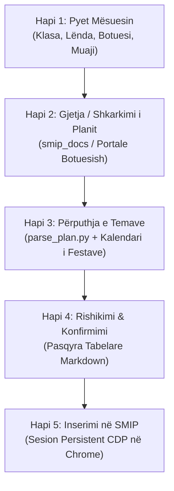
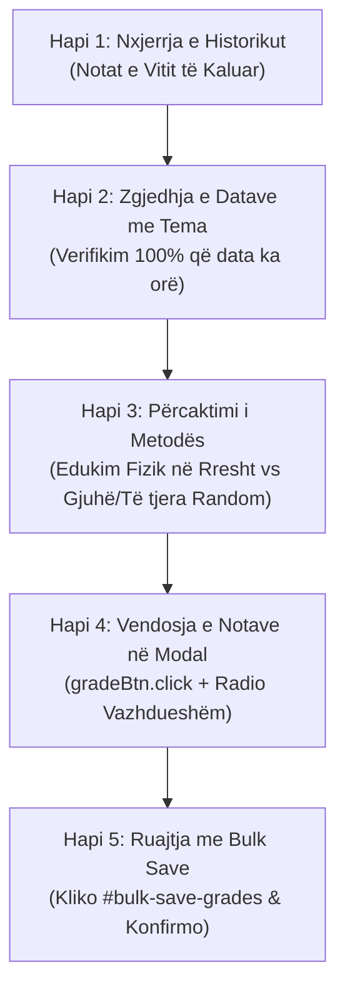

# SMIP Skill - Automatizimi i Regjistrit dhe Vlerësimit Parauniversitar

Ky skill ofron automatizim të plotë, të sigurt dhe të saktë për mësuesit në portalin zyrtar [smip.al](https://smip.al):
1. **Hedhja e Temave Ditore:** Analizimi i planeve vjetore, llogaritja e datave me festat zyrtare dhe inserimi në regjistër (`tab=daily-register`).
2. **Hedhja dhe Menaxhimi i Notave:** Nxjerrja e historikut nga vitet paraprake, vendosja e notave në regjistrin e periudhës (`tab=trimester-register`), dhe zbatimi i rregullave të kurrikulës me kompetenca.

---

## Rrjedha A: Hedhja e Temave Mësimore (5 Hapa)



### 1. Mbledhja e të Dhënave
Pyeteni mësuesin duke përdorur `ask_question` ose dialog interaktiv për:
* Klasën (p.sh. *6-A*, *7-A*, ose klasë kolektive e bashkuar *7 & 9*)
* Lëndën (p.sh. *Edukim fizik*, *Gjuhë angleze*, *Matematikë*)
* Shtëpinë botuese (p.sh. *Albas*, *Mediaprint*, *Pegi*, *ASCAP/MAS*)
* Muajin dhe orarin javor (ditët e javës dhe orët për ditë)

### 2. Gjetja ose Shkarkimi i Planit
* Kërkim lokal në `smip_docs/` me `find_curriculum.py`.
* Shkarkim automatik nga portalet zyrtare (*Portalishkollor*, *Mediaprint*, *Pegi*, *ASCAP*).
* Në mungesë, agjenti gjeneron temat zyrtare bazuar në kurrikulën e MAS.

### 3. Përputhja e Temave me Kalendarin
Përdorni `parse_plan.py` bashkë me `holiday_finder.py` për të përjashtuar automatikisht festat zyrtare dhe fundjavat:
```bash
python3 .agents/skills/smip/scripts/parse_plan.py \
  --file "smip_docs/<plani.docx>" \
  --grade "<klasa>" \
  --subject "<lenda>" \
  --month <muaji> \
  --year <viti> \
  --days '{"E Mërkurë": 2, "E Premte": 1}' \
  --start-index <ora_fillestare> \
  --output-json "temat_<muaji>_<viti>.json" \
  --output-md "temat_<muaji>_<viti>.md"
```

### 4. Lejet e Koordinatorit (`can_change`)
* Nëse koordinatori nuk e ka hapur ende regjistrin për atë muaj, butoni `#add-topic` është i fshehur (`can_change: false`).
* Agjenti i ruan temat në skedarë gati dhe pret hapjen e regjistrit për t'i inseruar menjëherë.

---

## Rrjedha B: Hedhja dhe Menaxhimi i Notave (`tab=trimester-register`)



### Rregullat Kryesore Pedagogjike dhe Ligjore të Vlerësimit:
1. **Arsimi Fillor (Klasat 1-A, 2-A, 3-A):**
   * **NUK marrin nota numerike ditore (4-10)** në SMIP.
   * Vlerësimi bëhet vetëm me nivele arritjeje cilësore në fund të periudhës. Mos tentoni të vendosni nota ditore numerike për këto klasa.
2. **Edukim Fizik:**
   * Notat vendosen **në rresht** (`rrjesht`) — të gjithë nxënësit e klasës vlerësohen në të njëjtën datë mësimore (test fizik / normë sportive).
   * **Data të ndara:** Klasat nuk duhet të ndajnë të njëjtën datë (çdo klasë vlerësohet në datën e saj të orarit).
3. **Gjuhë Angleze dhe Lëndët e Tjera:**
   * Notat shpërndahen në **data të rastësishme** përgjatë muajve (për të pasqyruar aktivizimin individual dhe përgjigjet me gojë).
4. **Përputhshmëria e Datës:**
   * Çdo datë ku vendoset notë **DUHET** të ketë domosdoshmërisht temë mësimore të zhvilluar në regjistrin e SMIP.
5. **Përputhshmëria me Vitin e Kaluar:**
   * Kur plotësohet regjistri i ri me nota fillestare, ruhet e njëjta notë që nxënësi ka pasur vitin e kaluar në të njëjtën lëndë.

---

## Procedura Teknike e Inserimit në React (`tab=trimester-register`)

### 1. Përzgjedhja Kaskadë e Filtrave (E Detyrueshme)
1. **Klasa e bashkuar:** Zgjidhni `"Jo"`.
2. **Klasa:** Zgjidhni klasën (p.sh. `"7-A"`), prisni 600-800ms.
3. **Lënda:** Zgjidhni lëndën (p.sh. `"Edukim fizik..."`), prisni 600-800ms.
4. **Periudha:** 
   > [!IMPORTANT]
   > Dropdown-i i Periudhës nuk ekziston në DOM derisa të zgjidhet Lënda. Pasi të zgjidhet lënda, klikoni kontrollin që përmban tekstin `"periudhën"` ose `"Periudha"` dhe zgjidhni `"Periudha e parë"`. Prisni 1200ms që tabela e nxënësve të ngarkohet plotësisht.

### 2. Modali i Notës dhe Klikimi Rezistent
Për çdo nxënës në rreshtin përkatës dhe datën e synuar:
```javascript
// 1. Hap modalin
const addBtn = cell.querySelector("button.jss-add-grade, #action-button");
addBtn.click();
await new Promise(r => setTimeout(r, 400));

// 2. Sigurohu që lloji është 'Vazhdueshem'
const contRadio = document.getElementById("evaluation-type-continuous");
if (contRadio && !contRadio.checked) contRadio.click();

// 3. Kliko butonin e notës me event vendas të plotë (JO thirrje e zhveshur props.onClick!)
const modal = document.querySelector(".modal-panel");
const gradeBtn = Array.from(modal.querySelectorAll(".jss-grade-button"))
  .find(b => b.innerText.trim() === targetGradeStr);
gradeBtn.click();
await new Promise(r => setTimeout(r, 400));
```

### 3. Ruajtja me Butonin Bulk Save (`#bulk-save-grades`)
* Butoni **"Ruaj Ndryshimet"** (`#bulk-save-grades`) shfaqet në faqe **VETËM kur ka ndryshime të paruajtura** (`dirtyList.length > 0`).
* Pasi vendosen të gjitha notat e klasës:
  ```javascript
  const saveBtn = document.getElementById("bulk-save-grades");
  if (saveBtn && !saveBtn.disabled) {
    saveBtn.click();
    await new Promise(r => setTimeout(r, 3000)); // Pritja e kërkesës API bulkSave
  }
  ```
* **Verifikimi:** Zhdukja e butonit `#bulk-save-grades` nga DOM konfirmon që ndryshimet u ruajtën me sukses.
* Kryeni gjithmonë screenshot konfirmimi në `screenshots/notat_<klasa>_<muaji>.png`.

---

## Ndryshimi i Vitit Shkollor në Header

Kur nevojiten të dhëna historike (notat e vitit të kaluar ose regjistrat e kaluar):
1. Gjeni kontrollin e vitit shkollor në header (`Viti shkollor`).
2. Klikoni mbi të dhe zgjidhni vitin e synuar (p.sh. `2025-2026`).
3. Lexoni regjistrat dhe notat e nxënësve.
4. Kthejeni vitin shkollor tek viti aktual mësimor (`2026-2027`).

---

## Mbrojtja e të Dhënave Personale (Data Privacy)

> [!CAUTION]
> Skedarët që përmbajnë emra realë të nxënësve, numra amze apo nota individuale **NUK DUHET të bëhen kurrë commit në Git**. Sigurohuni që të gjithë skedarët e përpunimit (`notat_*.json`, `rezultati_*.json`, `verifikimi_*.json`, `screenshots/*.png`) të jenë të mbrojtur në `.gitignore`.

---

## Skedarët dhe Referencat Kryesore

* Selektorët dhe ndërfaqja e SMIP: [`portal_selectors.md`](./references/portal_selectors.md)
* Orari dhe ngarkesa javore: [`orari_shembull.json`](./references/orari_shembull.json)
* Kalendari i festave zyrtare: `smip_docs/kalendari_pushimeve.json`
* Skripti CDP daemon për lidhjen e qëndrueshme me Chrome: `scripts/smip_cdp_worker.js`
