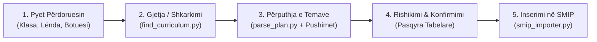

<p align="center">
  <div align="center">
    <h1>🏫 SMIP Skill</h1>
    <p><em>Asistenti inteligjent AI për regjistrin dhe planet mësimore në Shqipëri (<a href="https://smip.al">smip.al</a>)</em></p>
  </div>
</p>

<p align="center">
  <a href="https://adalenv.github.io/smip-skill/"></a>
  <a href="https://github.com/adalenv/smip-skill"></a>
  
  
</p>

<p align="center">
  
  
  
  
</p>

---

## 🎯 Përmbledhje

**SMIP Skill** automatizon plotësisht hedhjen e temave ditore dhe regjistrin mësimor në portalin zyrtar të arsimit parauniversitar në Shqipëri ([smip.al](https://smip.al)):

1. **Pyet mësuesin:** Klasën, lëndën, shtëpinë botuese dhe muajin e synuar.
2. **Gjen ose shkarkon planin:** Kërkon në bibliotekën lokale të dokumenteve ose në depot e botuesve (Albas, Mediaprint, Pegi, Smiles, Irisoft, ASCAP).
3. **Analizon & përputh temat:** Nxjerr temat dhe situatat e të nxënit nga skedari Word (`.docx`), duke përjashtuar automatikisht festat zyrtare dhe pushimet sipas kalendarit zyrtar shkollor.
4. **Paraqet pasqyrën tabelare:** Mësuesi rishikon dhe konfirmon planifikimin ditor.
5. **Inserimi 100% Autonom nga Agjenti:** Agjenti përdor Playwright për të hapur shfletuesin, lundron te `smip.al`, përzgjedh klasën, lëndën dhe muajin, dhe hedh të gjitha temat modal-pas-modali, duke ruajtur ndryshimet dhe duke marrë screenshot përfundimtar. Nuk kërkohet asnjë veprim manual apo ngjitje në konsolë!

🌐 **Eksploroni veglën interaktive në GitHub Pages:** [https://adalenv.github.io/smip-skill/](https://adalenv.github.io/smip-skill/)

---

## 🚀 Rrjedha e Punës (Workflow)



---

## 🤖 Mbështetja për Agjentët AI (Multi-Agent Compatibility)

Ky repozitor është ndërtuar për të funksionuar me të gjithë agjentët modernë të programimit dhe automatizimit:

| Agjenti AI | Mënyra e Integrimit | Komanda / Konfigurimi |
| :--- | :--- | :--- |
| **Google Antigravity** | Native Skill + Chrome CDP / `/browser` | `.agents/skills/smip` ose komanda `/browser` |
| **Claude Code** | MCP Server + Plugin zyrtar | `claude mcp add smip node ./scripts/smip_mcp.js` |
| **Cursor** | Cursor Agent + MCP Tools | Përdor `.cursor/mcp.json` dhe `.cursorrules` |
| **Windsurf** | Cascade MCP Server | Shtohet në konfigurimin MCP të Windsurf |
| **Cline / Roo Code** | Browser Actions + MCP | Importo `mcp.json` direkt në panelin MCP |
| **Devin** | Native Chrome Browser VM | Ekzekuton `node scripts/smip_bot.js --headful` |

---

## 📦 Instalimi dhe Përdorimi

### 1. Me Google Antigravity
Klonoje direkt brenda dosjes së konfigurimit të agjentit:
```bash
# Në projektin tuaj lokal
git clone https://github.com/adalenv/smip-skill.git .agents/skills/smip

# Ose globalisht në makinën tuaj
mkdir -p ~/.gemini/config/skills/smip
git clone https://github.com/adalenv/smip-skill.git ~/.gemini/config/skills/smip
```

### 2. Me Claude Code (via MCP)
```bash
claude mcp add smip node ./scripts/smip_mcp.js
```

### 3. Me Cursor
Repo përmban `.cursor/mcp.json` dhe `.cursorrules` të gatshëm. Mjafton të hapni dosjen në Cursor dhe veglat e SMIP do të shfaqen automatikisht te paneli i veglave të agjentit (Tools).

### 3. Nga Terminali (Python CLI)

#### Hapi A: Kërkimi i Planit Mësimor
```bash
python3 scripts/find_curriculum.py --grade 6 --subject "Edukim Fizik" --publisher "Albas"
```

#### Hapi B: Gjenerimi i Temave Mësimore
```bash
python3 scripts/parse_plan.py \
  --file "smip_docs/EDUKIM_FIZIK_6_Plani_me_simor_vjetor.docx" \
  --grade "Klasa 6 - 8" \
  --subject "Edukim Fizik" \
  --month 10 \
  --year 2026 \
  --days '{"E Hënë": 2, "E Premte": 1}' \
  --start-index 8 \
  --output-json "temat_tetor_2026.json" \
  --output-md "temat_tetor_2026.md"
```

#### Hapi C: Inserimi nga Agjenti (Lidhja me Chrome ose Playwright)

Agjenti ofron 3 mënyra të fuqishme integrimi:

1. **Lidhje Direkte me Google Chrome-in Tuaj Ekzistues (CDP):**
   Nëse jeni tashmë të kyçur në `smip.al` me e-Albania në Chrome:
   ```bash
   node scripts/smip_bot.js --open-chrome --topics "temat_tetor_2026.json" --class "Klasa 6 - 8" --subject "Edukim Fizik" --month "10/2026"
   ```
   Agjenti lidhet direkt me tab-in aktiv në dritaren tuaj të Chrome-it dhe kryen veprimet menjëherë pa kërkuar fjalëkalim.

2. **Përdorimi i Shfletuesit të Integruar në Antigravity (`/browser`):**
   Shkruani `/browser` në bisedë me Antigravity për të kontrolluar portalin direkt brenda IDE-së.

3. **Bot-i Autonom i Pavarur (Playwright):**
   ```bash
   node scripts/smip_bot.js \
     --topics "temat_tetor_2026.json" \
     --class "Klasa 6 - 8" \
     --subject "Edukim Fizik" \
     --month "10/2026" \
     --headful
   ```

---

## 🏛️ Shtëpitë Botuese dhe Burimet e Mbështetura

| Shtëpia Botuese / Institucioni | Seritë & Lëndët Kryesore | Lidhja Zyrtare |
| :--- | :--- | :--- |
| **ASCAP & MAS** | Programet Orientuese Kombëtare | [ascap.edu.al](https://ascap.edu.al) |
| **Botimet Albas** | Gjuhë Shqipe, Matematikë, Qytetari, Histori, Shkenca | [portalishkollor.al](https://portalishkollor.al) |
| **Botimet Mediaprint** | Planet Vjetore & Periudhore Fillor / 9-vjeçar / Gjimnaz | [mediaprint.al](https://mediaprint.al/planet-mesimore/) |
| **Botimet Pegi** | Planet mësimore lëndore dhe ditarët e mësuesit | [botimepegi.al](https://botimepegi.al/plane-mesimore/) |
| **Express Publishing** | Smiles 1–5, Right On 1–4, Spark, Flash | [expresspublishing.al](https://expresspublishing.al) |
| **Irisoft Education** | TIK 4–12, Aftësim Teknologjik, Robotikë | [irisoft.al](https://irisoft.al) |

---

## 📅 Kalendari Zyrtar dhe Pushimet (2026–2027)

Ky mjet përdor kalendarin zyrtar `smip_docs/kalendari_pushimeve.json` me të gjitha datat zyrtare të përcaktuara nga Urdhri i Ministrisë së Arsimit:
* **Pushimet e Dimrit:** 24 Dhjetor 2026 – 4 Janar 2027
* **Pushimet e Pranverës:** 29 Mars 2027 – 2 Prill 2027
* **Festa Kombëtare:** 28 Nëntor (Pavarësia), 29 Nëntor (Çlirimi), 8 Dhjetor (Dita e Rinisë), etj.
* **Festa Fetare me Datë të Lëvizshme:** Fitër Bajrami, Pashkët Katolike & Ortodokse, Kurban Bajrami (me rregullin e transferimit të pushimit të hënën kur bie në fundjavë).

---

## 🛡️ Rregulli i Sigurisë 24-Orësh në SMIP

> [!IMPORTANT]
> Portali SMIP lejon modifikimin e menjëhershëm të temave dhe notave ditore brenda **24 orëve** nga momenti i regjistrimit. Pas 24 orësh, fusha bllokohet dhe ndryshimet kërkojnë arsyetim me shkrim dhe miratim nga sekretaria/drejtoria. Skriptet tona gjithmonë shfaqin preview për konfirmim para ruajtjes finale me `#bulk-save-grades`.

---

## 📄 Licenca

Ky projekt është i licencuar nën [MIT License](./LICENSE). Ndërtuar me pasion për mësuesit nga [Adalenv](https://github.com/adalenv).
